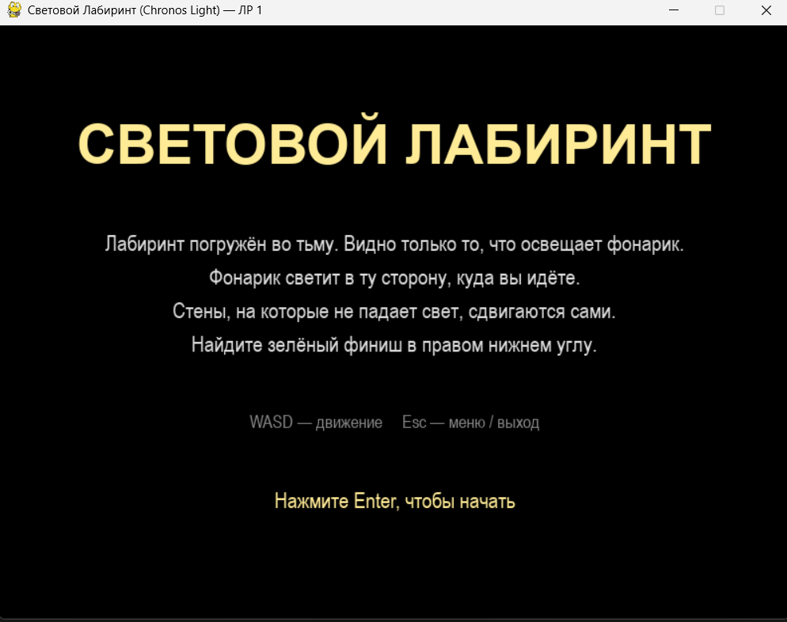
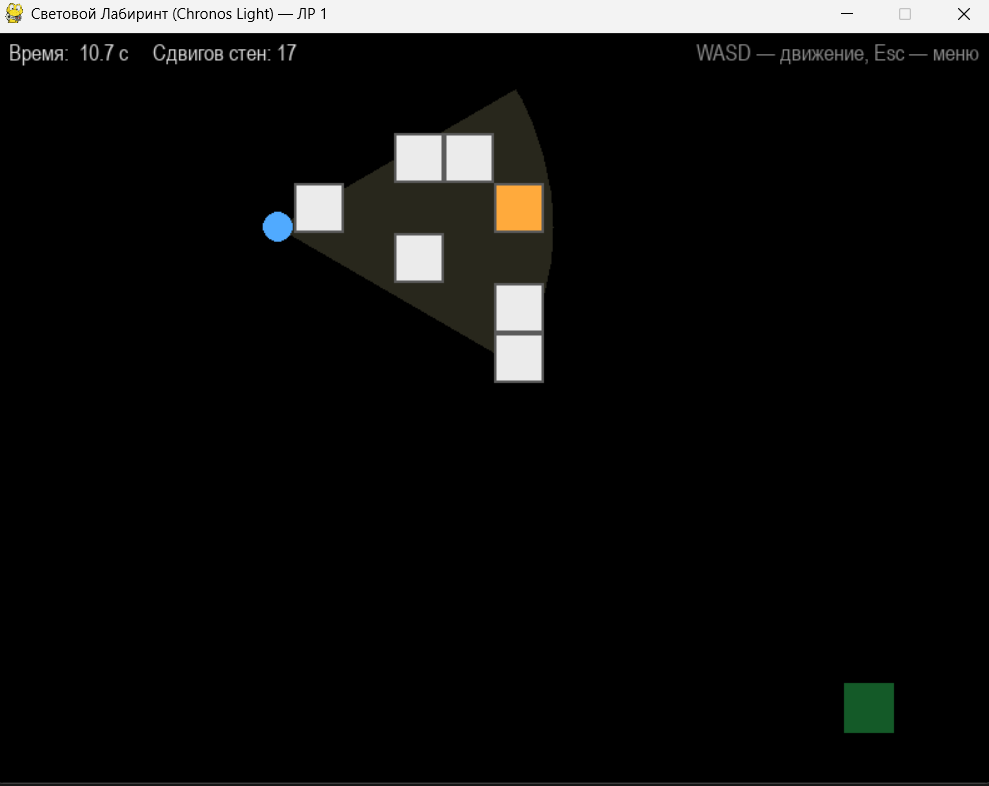
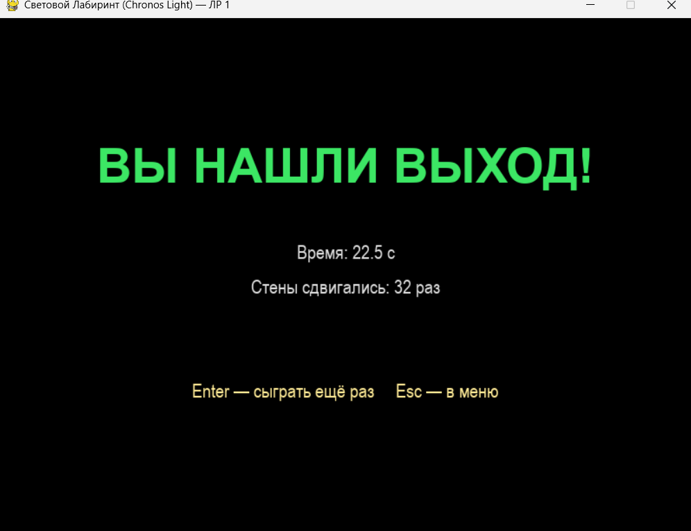

# Световой Лабиринт (Chronos Light)

Лабораторная работа № 1 «Алгоритмизация на языке Python», вариант 18.
Игра на Python + Pygame: лабиринт погружён во тьму, виден только конус света
от фонарика перед персонажем. **Динамические стены двигаются только тогда,
когда на них не падает свет.**

> ФИО: _впишите ФИО_ · Группа: _впишите группу_

## Скриншоты

| Стартовый экран | Игра | Экран завершения |
|:---:|:---:|:---:|
|  |  |  |

## Правила игры

- Весь лабиринт залит темнотой. Игрок видит только то, что попало в луч фонарика.
- Фонарик светит в ту сторону, куда игрок двигался в последний раз.
- Белые блоки — обычные стены, оранжевые — динамические.
- Динамические стены, на которые **не** падает свет, каждые 1,5 секунды сдвигаются
  на одну клетку влево или вправо. Стоит осветить такую стену — она замирает.
- Цель — дойти до зелёного финиша в правом нижнем углу. Он слабо виден в темноте
  и ярко загорается в луче света.

## Управление

| Клавиша | Действие |
|---|---|
| `W` `A` `S` `D` | движение и поворот фонарика |
| `Enter` | начать игру / сыграть ещё раз |
| `Esc` | вернуться в меню (из меню — выход) |

## Установка и запуск

Нужен Python 3.12 или новее.

```bash
pip install -r requirements.txt
python main.py
```

Если установка не проходит, проверьте версию Python: для самых новых выпусков
готовой сборки Pygame может ещё не быть, тогда используйте Python 3.12 или 3.13.

В Visual Studio: откройте проект, выберите окружение Python 3.12 с установленным
`pygame`, назначьте `main.py` файлом запуска и нажмите **Ctrl+F5**.

## Как это работает

### Лабиринт
Лабиринт описан матрицей блоков 15×20 в `constants.py` (`LEVEL_LAYOUT`).
При запуске строки переводятся в числовую матрицу и список объектов `Wall`:

| Значение | Тип блока |
|:---:|---|
| 0 | пустая клетка |
| 1 | обычная стена |
| 2 | динамическая стена |
| 3 | старт |
| 4 | финиш |

### Конус света (`flashlight.py`)
Блок освещён (`lit = True`), если выполняются два условия:

1. расстояние от игрока до центра блока не больше радиуса `R`
   (`math.hypot(dx, dy) <= LIGHT_RADIUS`);
2. угол между вектором взгляда игрока и вектором «игрок → блок» меньше 30°
   (`abs(atan2(dy, dx) - facing) <= 30°`, разница углов нормируется в диапазон
   от −π до π).

Рисуются **только** освещённые стены (`Wall.draw` ничего не делает при `lit == False`).

### Движение стен (`maze.py`)
Каждый кадр для каждой динамической стены с `lit == False` проверяется таймер.
Если прошло 1,5 с, стена пытается сдвинуться на клетку в своём направлении:

- если клетка свободна и в ней нет игрока — стена переезжает, а значение
  меняется в матрице (клетка слева освобождается, справа становится `2`);
- если клетка занята — стена разворачивается и пойдёт в другую сторону.

Динамические стены стоят в открытых комнатах 3×3, поэтому полностью перекрыть
проход они не могут, и лабиринт всегда проходим.

### Игрок (`player.py`)
Движение по осям X и Y считается отдельно, поэтому игрок скользит вдоль стен.
Скорость по диагонали нормируется. Направление взгляда — угол последнего движения.

## Структура проекта

```
.
├── main.py          # точка входа
├── game.py          # класс Game: окно, цикл, состояния MENU / PLAY / WIN, отрисовка
├── maze.py          # класс Maze: матрица, освещение, движение динамических стен
├── wall.py          # класс Wall: блок стены (dynamic, lit)
├── player.py        # класс Player: движение, столкновения, взгляд
├── flashlight.py    # математика конуса света
├── constants.py     # размеры, цвета, параметры света и стен, карта лабиринта
├── requirements.txt
├── README.md
└── screenshots/     # скриншоты для README
```

## Настройка

Все параметры в `constants.py`: `LIGHT_RADIUS` (дальность луча),
`LIGHT_HALF_ANGLE_DEG` (половина угла обзора), `PLAYER_SPEED`,
`DYNAMIC_WALL_INTERVAL_MS` (как часто двигаются неосвещённые стены),
а также карта `LEVEL_LAYOUT`.

## Соответствие требованиям ЛР 1

| Требование | Где реализовано |
|---|---|
| Окно Pygame не меньше 800×600 | `constants.py`, `game.py` |
| Лабиринт — матрица блоков, часть блоков `dynamic` | `constants.py`, `maze.py`, `wall.py` |
| Управление WASD | `player.py` |
| Алгоритм фонарика (расстояние и угол < 30°, `lit`) | `flashlight.py`, `Maze.update_lighting` |
| Движение неосвещённых динамических стен | `Maze.update_dynamic_walls` |
| Отрисовка только освещённых стен | `Wall.draw` |
| Стартовый экран, HUD, экран завершения | `game.py` |
| Модули, константы в отдельном файле, комментарии | весь проект |
